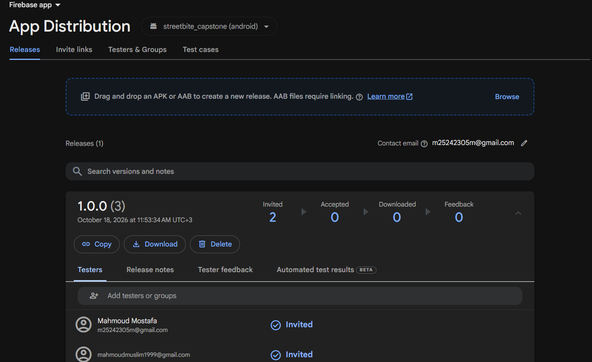
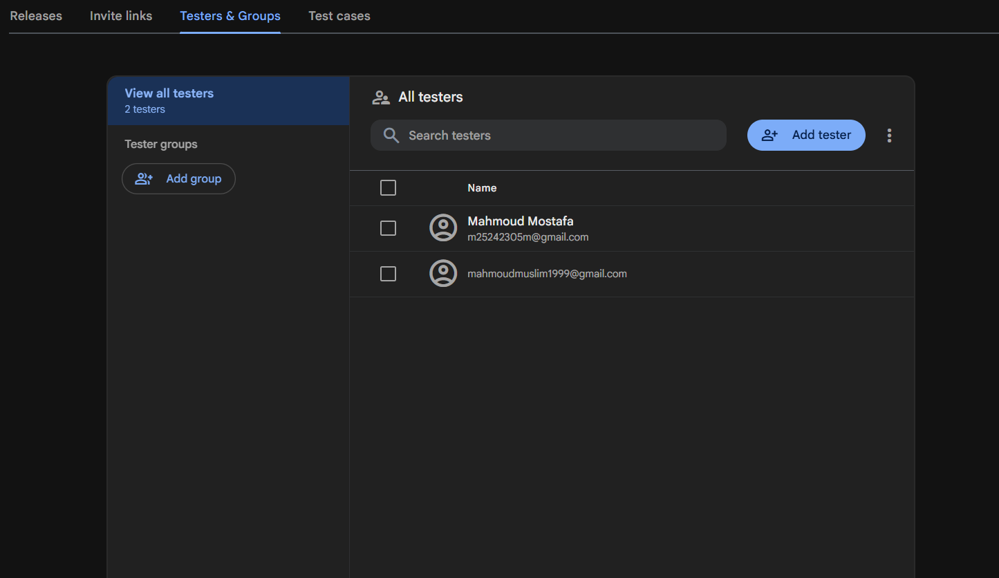

<div align="center">

# StreetBite — Hyperlocal Food Discovery & Ordering


**Flutter 3.47 · Dart 3.13 · Firebase · Clean Architecture**


-12141A)


</div>

StreetBite is a hyperlocal food-discovery app: users browse a live menu pulled
from [TheMealDB](https://www.themealdb.com/api.php), find vendors on a live
Google Map, order from street-food kitchens, save favourites, sign in again with
a fingerprint, and manage their profile behind a biometric gate — in English or
Arabic, light or dark.

> [!NOTE]
> Built for the **StreetBite Ventures** graduation capstone.

---

## Table of contents

1. [Screens](#screens)
2. [Feature tour](#feature-tour)
3. [Architecture](#architecture)
4. [Design patterns, and where each one is used](#design-patterns-and-where-each-one-is-used)
5. [Folder structure](#folder-structure)
6. [Setup](#setup)
7. [Permissions](#permissions)
8. [Configuration](#configuration)
9. [Testing](#testing)
10. [Build & Firebase App Distribution](#build--firebase-app-distribution)
11. [Known limitations](#known-limitations)

---

## Screens

Implemented from the [Food Delivery Mobile App UI Kit](https://www.figma.com/community/file/1352761962360670057/food-delivery-mobile-app-ui-kit):

| Screen | File | Notes |
|---|---|---|
| Splash / Onboarding | `presentation/screens/splash/splash_screen.dart` | Fade-in logo, session restore in parallel with the animation |
| Login | `presentation/screens/auth/login_screen.dart` | Firebase Auth + inline validation + localized SnackBars |
| Sign Up | `presentation/screens/auth/signup_screen.dart` | Name capitalisation, confirm dialog, fade into Home |
| Biometric sign-in | `presentation/screens/auth/biometric_login_screen.dart` | Cold-start fingerprint gate; declines to the password form without signing the session out |
| Home feed | `presentation/screens/home/home_screen.dart` | Banner `PageView`, Hot Offers strip, 2-column meals grid |
| Meal details | `presentation/screens/home/meal_details_screen.dart` | `BlocConsumer` → live badge + SnackBar, favourites write |
| Cart & checkout | `presentation/screens/cart/cart_screen.dart` | `BlocBuilder` list, `BlocListener` empty SnackBar, payment strategies |
| Order confirmation | `presentation/screens/cart/order_confirmation_screen.dart` | Arrival estimate |
| Order details | `presentation/screens/orders/order_details_screen.dart` | Receipt, payment line written by the strategy, reorder into the cart |
| Browse | `presentation/screens/browse/browse_screen.dart` | Category grid + entry point to the map |
| Orders | `presentation/screens/orders/orders_screen.dart` | Current / Past split, live from Firestore |
| Vendor map | `presentation/screens/map/vendor_map_screen.dart` | 5 markers across 5 cities, custom info window |
| Profile | `presentation/screens/profile/profile_screen.dart` | Biometric gate, `device_info_plus`, `image_picker`, favourites + history |
| Settings | `presentation/screens/settings/settings_screen.dart` | Appearance and language pickers, Security card with the fingerprint sign-in opt-in |

---

## Feature tour

### Authentication
Email/password against **Firebase Auth**, with the session persisted so a
restart skips Login. The full name is capitalised through
`capitalizeEachWord()` before it reaches Firestore. Firebase error codes are
translated to localized sentences by a single table
(`AuthRemoteDataSource.mapAuthError`).

### Fingerprint sign-in
A returning user who has switched the opt-in on in **Settings → Security** lands
on a biometric gate instead of the password form. `AuthCubit.restore()` emits
`AuthBiometricGate` rather than `AuthAuthenticated`, and only a passed scan
promotes it — so the Firebase session is never handed out unverified. A skipped
or failed scan falls back to the password form and deliberately **does not** sign
the user out: the session is still valid, and logging it out would punish a
finger that simply slipped.

The round fingerprint button beside **Log In** is that fallback's way back: it
re-reads the persisted session and, when one exists *and* this device opted in,
re-opens the gate without typing anything. With nothing to unlock it says so
instead of showing a prompt that could never pass — biometrics never replace
credentials here, they only stand aside for a session already on the handset.

The opt-in itself is device state, not account state, so it lives in
`shared_preferences` behind `GetBiometricSignIn` / `SetBiometricSignIn` — another
device keeps its own choice. Switching it *on* requires a passed scan first,
because that is the moment the device gains the ability to open the account
without a password.

### Orders and the delivery window
`CartBloc` writes every order with `status: active`, and nothing rewrites it: no
client can observe the kitchen. `OrderEntity.statusAt(now)` therefore resolves
the stored snapshot against `AppConstants.orderActiveWindow` (45 minutes, wider
than the 25–30 minute arrival estimate the confirmation screen promises), and
`GetOrderHistory` applies it on the way out. The Orders split, the tiles and the
receipt all read `order.status` and stay untouched.

### Live menu feed
`MealRemoteDataSource` calls TheMealDB through `DioClient`; `MealLocalDataSource`
mirrors the payload into `shared_preferences`. The repository picks between them
— see [Factory pattern](#factory-pattern-1-data-source-selection).

TheMealDB has no prices, so `MealModel.priceForId()` derives a **deterministic**
price from the meal id. Cached and freshly-fetched menus therefore always agree,
which matters because the cart total is persisted.

### Cart & checkout
`CartBloc` is a full event-driven Bloc (`CartItemAdded`, `CartItemRemoved`,
`CartItemQuantityChanged`, `CartCleared`, `CartCheckoutRequested`). Every
mutation is delegated to a use case, so the Bloc contains orchestration and no
business rules. Payment is a set of strategies — see
[SOLID](#solid-principle-1-payment).

### Vendor map
Five hardcoded vendors in Cairo, Dubai, London, New York and Tokyo. Tapping a
marker opens a custom info window with the name, cuisine, rating and distance.
A `MapErrorBoundary` swaps in a friendly panel when the platform view fails
(missing Play Services or API key), so the screen never white-screens.

### Profile
The avatar is behind a fingerprint/face gate (`local_auth`). The device card
reads the model and OS through `device_info_plus`. The camera badge opens
`image_picker`, writes the photo to Firestore and updates the avatar in the
same frame. Favourites and order history are read live from Firestore.

### Localization
`lib/l10n/app_en.arb` and `app_ar.arb` are the **only** source of user-facing
text. `L10nX.trKey()` is an exhaustive `switch` over every key, so adding a
string without wiring it is a compile-time error. Language and appearance are
chosen in **Settings** — the two `AppSegmentedPicker`s there drive `LocaleCubit`
and `ThemeCubit`, which rebuild the whole `MaterialApp` at runtime with no
restart and flip the layout for Arabic. A quick toggle also stays in the app bar
of the screens a user reaches *before* Settings (splash, Login, Sign Up,
fingerprint sign-in) and on Profile, because those have no other way to change
either setting.

### Cross-device & cross-account continuity
Anything that belongs to the user is stored in Cloud Firestore under their own
uid, not on the handset — so signing in on a second device restores favourites,
order history and profile, while a different account can never read them.

<p align="center">
  
</p>

`firestore.rules` nests every document under the owner (`users/{uid}`,
`users/{uid}/favourites/{mealId}`, `orders/{uid}/items/{orderId}`) and allows
`read, write` only when `request.auth.uid == uid` — no `list()`, no public read,
no wildcard, and it **fails closed** for any collection without a rule. Orders
are deliberately not a shared collection precisely so that owner scoping can be
enforced at the path. The same release APK on a physical handset and on an
emulator therefore shows the same account's data, and nothing of anyone else's.

---

## Architecture

```
┌──────────────────────────────────────────────────────────────┐
│  Presentation                                               │
│  screens · blocs (Cubit + Bloc) · widgets · extensions        │
│  ┌────────────────────────────────────────────────────────┐  │
│  │  Domain  (pure Dart — no Flutter, no Dio, no Firebase) │  │
│  │  entities · repositories (interfaces) · usecases        │  │
│  └────────────────────────────────────────────────────────┘  │
│  ┌────────────────────────────────────────────────────────┐  │
│  │  Data                                                    │  │
│  │  models (fromJson/toJson) · datasources · repositories   │  │
│  └────────────────────────────────────────────────────────┘  │
│  Core  constants · error · network · theme · usecase · utils │
└──────────────────────────────────────────────────────────────┘
```

**Dependency rule:** dependencies point inward only.
`presentation → domain ← data`. The domain layer imports nothing from Flutter,
Dio or Firebase, which is why every use case is unit-testable in milliseconds.

**Error handling.** No repository throws. `DioClient` converts every
`DioException` into a typed `NetworkException`; repositories convert those into
a `Failure` carrying an **ARB key**; the UI resolves the key through
`context.trKey()`. The result is a sealed `Either<Failure, T>`, so the compiler
forces the caller to handle the failure branch — which is how "no unhandled
exceptions anywhere" is enforced rather than merely hoped for.

---

## Design patterns, and where each one is used

### Singleton pattern — `data/datasources/firestore_service.dart`
`FirestoreService` has a private constructor and a `factory` that always
returns the same instance. One place configures Firestore, so the offline cache
is consistent: a favourite written by the Cart screen is immediately visible to
the Profile screen. Registered as a `lazySingleton` in `injection.dart`.

### Builder pattern — `data/models/user_model.dart`
A `UserEntity` is produced from four places that each know a different subset
of the fields (Firebase sign-up, a Firestore document, a silent restore, the
local fallback store). `UserModel.builder()` lets a call site set **only what it
actually knows**:

```dart
final user = UserModel.builder()
    .uid(credential.uid)
    .email(email)
    .displayName('Yasmine Adel')
    .build();
```

### Factory pattern 1 (data source selection) — `data/repositories/meal_repository_impl.dart`
`selectDataSource(MealDataSource)` maps an *intent* onto the concrete pair of
data sources to use. The decision lives in one method rather than a `switch`
scattered across call sites, so adding a third backend means one enum value and
one branch.

### Factory pattern 2 (strategy creation) — `domain/entities/payment.dart`
`PaymentFactory.create(PaymentType)` rehydrates a strategy from its persisted
discriminator, so callers never `switch` over an enum themselves.

### Factory Method pattern (dependency injection) — `injection.dart`
Every repository is registered against its **abstract interface**:
`sl.registerLazySingleton<MealRepository>(() => MealRepositoryImpl(...))`. No
other layer ever imports `MealRepositoryImpl`, so swapping the implementation is
a one-line change in one file.

### SOLID principle 1 (payment) — `domain/entities/payment.dart`
* **S**ingle responsibility — `CashPayment` collects money on delivery,
  `CardPayment` charges a saved card.
* **O**pen/closed — the checkout screen depends on the `PaymentMethod`
  *abstraction*; a wallet payment is added without touching it.
* **L**iskov substitution — any strategy is interchangeable behind the
  interface.
* **I**nterface segregation — three narrow members, nothing extra.
* **D**ependency inversion — the screen never imports a concrete payment class.

### Repository pattern — `domain/repositories/*` + `data/repositories/*`
Interfaces live in the domain layer; the Dio/Firebase implementations live in
the data layer and are injected. The Firestore singleton is reached *only*
through the repository abstraction, which is what lets the app run with no
Firebase configuration at all.

### Use case pattern — `domain/usecases/*`
One public `call` method each. `CartBloc` depends on four of them, so the cart
is unit-tested with four mocks and no widgets. Pure computations
(`AddToCart`, `CalculateOrderTotals`) implement `SyncUseCase` — wrapping them in
a `Future` would only add microtask hops.

---

## Folder structure

```
streetbite_capstone/
├── lib/
│   ├── main.dart                  # entry point + boot sequence
│   ├── app.dart                   # MaterialApp, theme/locale wiring, providers
│   ├── injection.dart             # GetIt service locator
│   ├── core/
│   │   ├── constants/             # AppConstants, AppRoutes
│   │   ├── error/                 # Failure, exceptions, Either
│   │   ├── network/               # DioClient
│   │   ├── theme/                 # AppColors, AppTheme
│   │   ├── usecase/               # UseCase / SyncUseCase contracts
│   │   └── utils/                 # Validators, Responsive, string helpers
│   ├── data/
│   │   ├── datasources/           # remote + local + FirestoreService (singleton)
│   │   ├── models/                # fromJson / toJson, Builder, SOLID snapshots
│   │   ├── repositories/          # interface implementations
│   │   └── services/              # BiometricService
│   ├── domain/
│   │   ├── entities/              # pure Dart value objects
│   │   ├── repositories/          # abstract interfaces
│   │   └── usecases/              # one public call() each
│   ├── presentation/
│   │   ├── blocs/                 # auth · cart · favourites · locale ·
│   │   │                          # meals · orders · profile · theme
│   │   ├── extensions/            # L10nX — the key → sentence bridge
│   │   ├── router/                # AppRouter (onGenerateRoute)
│   │   ├── screens/               # one directory per flow
│   │   └── widgets/               # reusable widgets
│   └── l10n/
│       ├── app_en.arb
│       ├── app_ar.arb
│       └── generated/             # flutter gen-l10n output
├── test/                          # 99 unit + widget tests across 15 suites
├── android/
│   ├── key.properties.example     # copy to key.properties
│   └── app/google-services.json   # Firebase config
├── pubspec.yaml
└── README.md
```

**One class, one file.** Every screen, Cubit/Bloc, use case, repository, model,
service and reusable widget has its own file, including the small ones
(`MetaPill`, `InfoRow`, `SettingsRow`, `SectionHeader`) — which is why
reusing a widget is always a one-line import.

---

## Setup

### Prerequisites

| Tool | Version |
|---|---|
| Flutter | 3.47.0 (stable) |
| Dart | 3.13.0 |
| Android Studio | Ladybug or newer |
| JDK | 17 |
| Android SDK | compileSdk 36, minSdk 24 |

### Run it

```bash
git clone <your-repo-url> streetbite-capstone
cd streetbite-capstone/streetbite_capstone

flutter pub get
flutter gen-l10n          # regenerate AppLocalizations from the ARB files
flutter run
```

The app runs immediately — **no Firebase project required**. When
`Firebase.initializeApp()` cannot reach the SDK, the repositories fall back to
on-device data sources (see [Resilience](#resilience-and-the-offline-fallback)),
so sign-up, login, favourites, orders and the whole feed keep working.

### Test data

| Field | Value |
|---|---|
| Email | `yasmine@streetbite.app` |
| Password | `StreetBite123` |
| Name | `Yasmine Adel` |

Seeded on first launch (idempotent) so the Appium suite has a valid account. The
Login screen is pre-filled with it.

---

## Permissions

Declared in `android/app/src/main/AndroidManifest.xml`:

| Permission | Used by | Why |
|---|---|---|
| `INTERNET` | Dio, Firestore | TheMealDB feed and Firebase sync |
| `ACCESS_NETWORK_STATE` | Dio | Distinguishes "offline" from "server error" |
| `ACCESS_COARSE_LOCATION` | Vendor map | Vendor distance hint |
| `ACCESS_FINE_LOCATION` | Vendor map | Required by the Maps SDK for the blue dot |
| `USE_BIOMETRIC` | `local_auth` | Profile gate and fingerprint sign-in |
| `READ_MEDIA_IMAGES` | `image_picker` | Profile photo (Android 13+) |
| `READ_EXTERNAL_STORAGE` | `image_picker` | Profile photo (≤ Android 12, `maxSdkVersion=32`) |

`android.hardware.fingerprint` is declared with `required="false"` — a device
without a sensor can still install the app, and the gate offers a bypass.

No `MANAGE_EXTERNAL_STORAGE`, no background location, no contacts.

---

## Configuration

### Google Maps

A key alone is not enough — the Maps SDK for Android renders a blank canvas
with no Dart-visible error unless **all four** of these are true:

1. **A billing account is attached** to the Google Cloud project. Google
   rejects token requests ("Authorization failure") without it, even inside the
   free monthly credit.
2. **Maps SDK for Android is enabled** —
   [console.cloud.google.com/apis/library](https://console.cloud.google.com/apis/library)
   → search *Maps SDK for Android* → **Enable**. (Check with
   `https://maps.googleapis.com/maps/api/staticmap?...&key=<key>`: it answers in
   plain text which Maps APIs the project has activated.)
3. **The key allows this app's signing certificate.** Either leave the key
   unrestricted while developing, or add an *Android apps* restriction with the
   SHA-1 Google's own logcat line prints:

   ```
   adb logcat | grep "Google Android Maps SDK"
   #  Android Application (<cert_fingerprint>;<package_name>):
   #  85:39:45:FC:4A:8C:4C:70:4B:E6:00:97:C2:02:19:66:73:79:29:4D;com.example.streetbite_capstone
   ```

   That SHA-1 is the **debug** keystore (`~/.android/debug.keystore`); a release
   build needs its own fingerprint added to the same key.
4. **The key reaches the manifest** — `MAPS_API_KEY` is read from
   `android/key.properties` and substituted into
   `com.google.android.geo.API_KEY` by `app/build.gradle.kts`:

   ```bash
   cd streetbite_capstone/android
   cp key.properties.example key.properties
   # paste your Maps SDK for Android key
   ```

`key.properties` is git-ignored. Without a key — or with any of the four
conditions unmet — the map still opens and renders `AppErrorView` instead of
crashing, and the vendor list button keeps all five stops reachable
(`TC_MAP_004`).

### Firebase

`android/app/google-services.json` is already in place for package
`com.example.streetbite_capstone`. To use your own project:

1. Firebase console → **Add app → Android**, package `com.example.streetbite_capstone`.
2. Download `google-services.json` into `streetbite_capstone/android/app/`.
3. **Authentication → Sign-in method** → enable **Email/Password**.
4. **Firestore Database** → create, then paste the rules below.

The Google Services Gradle plugin is applied **conditionally** (only when the
file exists), so a fresh clone still builds:

```kotlin
if (file("google-services.json").exists()) {
    apply(plugin = "com.google.gms.google-services")
}
```

Recommended Firestore rules (per-user scoping):

```javascript
rules_version = '2';
service cloud.firestore {
  match /databases/{database}/documents {
    match /users/{userId} {
      allow read, write: if request.auth != null && request.auth.uid == userId;
      match /favourites/{mealId} {
        allow read, write: if request.auth != null && request.auth.uid == userId;
      }
    }
    match /orders/{userId}/items/{orderId} {
      allow read, write: if request.auth != null && request.auth.uid == userId;
    }
  }
}
```

### Resilience and the offline fallback

`AuthRepositoryImpl` applies a deliberate two-tier policy:

1. Try Firebase.
2. On a **credential** rejection (`wrong-password`, `email-already-in-use`, …)
   surface the error verbatim — falling back would hide a real rejection and
   produce false-positive QA results.
3. On a **connectivity / configuration** failure, retry against
   `AuthLocalDataSource` so sign-up, login and session restore keep working.

The same idea governs the repositories: `MealRepositoryImpl` serves the
`shared_preferences` copy when the network is down, and the Firestore-backed
repositories resolve locally when Firestore is not configured. Set
`AppConstants.allowOfflineFirebaseFallback = false` for a production build that
should fail loudly instead.

---

## Testing

```bash
cd streetbite_capstone
flutter analyze     # No issues found!
flutter test        # 99 tests, all green
dart format .       # formatting check
```

| Suite | File | Covers |
|---|---|---|
| Cart use cases | `test/domain/cart_use_cases_test.dart` | Add / remove / totals, free-delivery boundary, immutability |
| Order lifecycle | `test/domain/order_lifecycle_test.dart` | `statusAt` inside / on the boundary / after the window, an already-past order, clock skew, `GetOrderHistory` mapping and failure passthrough |
| Orders split | `test/presentation/orders_lifecycle_test.dart` | An order the cart wrote as `active` reaches **Past** through `OrdersCubit` |
| Models | `test/data/models_test.dart` | `fromJson`/`toJson` round trips, Builder defaults, payment rehydration |
| Category table | `test/core/app_categories_test.dart` | TheMealDB matching, every chip label key resolves, unique API categories |
| `CartBloc` | `test/presentation/cart_bloc_test.dart` | Events, `justEmptied` edge case, successful and failed checkout |
| Cart stepper | `test/presentation/cart_line_action_test.dart` | The +/− line action on a card |
| Login screen | `test/presentation/login_screen_test.dart` | Rendering, EN/AR, validation, SnackBars, navigation |
| Auth gate | `test/presentation/auth_biometric_gate_test.dart` | Gate on/off, confirm, declining falls back to the password form **without** signing out, restore failure |
| Fingerprint screen | `test/presentation/biometric_login_screen_test.dart` | Passed scan → Home; unavailable sensor, rejected and cancelled scan → password form |
| Settings opt-in | `test/presentation/settings_biometric_sign_in_test.dart` | Switch hidden without a sensor, a scan is required before storing `enabled`, turning it off needs none |
| Meal details | `test/presentation/meal_details_screen_test.dart` | `BlocConsumer` badge/SnackBar, favourite write |
| Order details | `test/presentation/order_details_screen_test.dart` | Receipt lines, the payment row written by the strategy, cash vs card |
| Localisation bridge | `test/presentation/l10n_extension_test.dart` | Every dynamic key resolves to a real sentence — no "Something went wrong" |
| Theme sheet | `test/presentation/theme_options_sheet_test.dart` | Each appearance, persistence, exactly one marked active |

Two bugs were found by these tests during development and fixed:
`AppTextField` was rendering raw ARB *keys* instead of localized sentences, and
the signed-in screen kept rendering Login while the locale toggled.

---

## Build & Firebase App Distribution

```bash
cd streetbite_capstone
flutter build apk --release
# -> build/app/outputs/flutter-apk/app-release.apk
```

> The release build is signed with the debug key so the App Distribution upload
> works out of the box. Generate an upload key before a real Play release:
> `keytool -genkey -v -keystore ~/streetbite-upload.jks -keyalg RSA -keysize 2048 -validity 10000 -alias upload`

### Upload to App Distribution

```bash
npm install -g firebase-tools
firebase login
firebase appdistribution:distribute \
  build/app/outputs/flutter-apk/app-release.apk \
  --app "1:441539093867:android:0fc0d7ea3c6f46c255582e" \
  --testers "yasmine@streetbite.app,mahmoud@streetbite.app" \
  --release-notes "StreetBite 1.0.0 - first public beta"
```

Add testers once from the console under **App Distribution → Testers →
Add testers**, then re-run the command above.

### Beta distribution evidence (verified)

The command above was run against the current release APK and completed
successfully:

| Item | Value |
|---|---|
| Firebase project | `studio-3887960052-c09f5` |
| Android app | `com.example.streetbite_capstone` (`…0fc0d7ea3c6f46c255582e`) |
| APK uploaded | `build/app/outputs/flutter-apk/app-release.apk` (60.2 MB) |
| Release | `1.0.0 (3)` — `uploaded new release 1.0.0 (3) successfully!` |
| Release ID | `6nmj4hn1eubc8` |
| Testers (2 invited) | `m25242305m@gmail.com`, `mahmoudmuslim1999@gmail.com` (see dashboard below) |
| Result | `added release notes successfully` · `distributed to testers/groups successfully` |

The raw CLI transcript is saved at
[`manual_qa/screenshots/firebase_app_distribution_cli_output.txt`](../manual_qa/screenshots/firebase_app_distribution_cli_output.txt).

Dashboard links (open while signed in to the project account):

* Release page — <https://console.firebase.google.com/project/studio-3887960052-c09f5/appdistribution/app/android:com.example.streetbite_capstone/releases/6nmj4hn1eubc8>
* Testers page — <https://console.firebase.google.com/project/studio-3887960052-c09f5/appdistribution/app/android:com.example.streetbite_capstone/testers>

**Dashboard evidence.** The App Distribution console shows release `1.0.0 (3)`
with **Invited: 2** testers, and the Testers & Groups tab lists both accounts:





### Windows note

`android/gradle.properties` disables Kotlin incremental compilation
(`kotlin.incremental=false`). The memory-mapped `.tab` caches cannot be closed
on Windows when a virus scanner or the Windows Search index holds a handle, and
the failure (`Could not close incremental caches`) is otherwise fatal to the
build. The cost is a few seconds per plugin module.

---

## Known limitations

* **Prices are synthetic.** TheMealDB has no price field, so
  `MealModel.priceForId()` derives a deterministic price in the \$6.99–\$24.99
  band. A real build would join against the vendor's catalogue.
* **Vendors are hardcoded.** Five seeds in `VendorLocalDataSource`. Replacing
  them with a Firestore geo-query touches that one file — `VendorRepository`
  and the map screen stay unchanged.
* **The delivery window is simulated.** Nothing tells the app when a vendor
  hands over the bag, so an order leaves **Current** 45 minutes after
  `placedAt` (`AppConstants.orderActiveWindow`). A real build would read a
  vendor-side status write and keep `statusAt` only as the safety net.
* **No order cancellation or vendor-side tooling.** Out of scope for V1.
* **iOS is scaffolded but unconfigured.** No `GoogleService-Info.plist`, no
  Podfile lock; the task targeted Android.

---

## License

Academic project — StreetBite Ventures capstone.